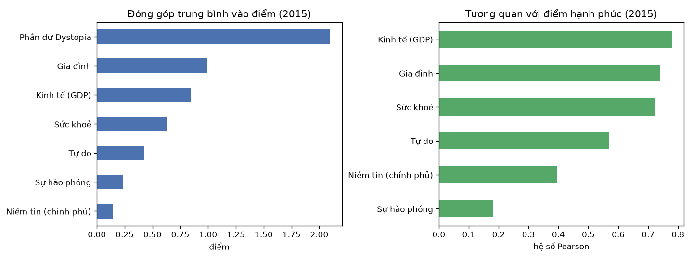
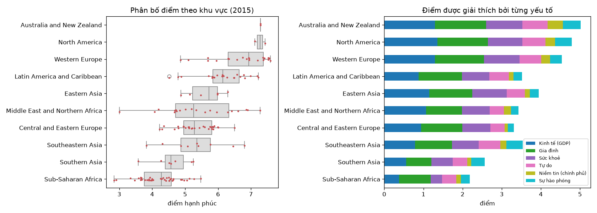
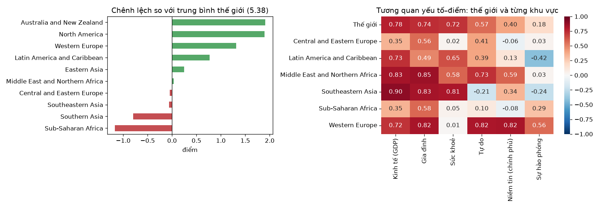
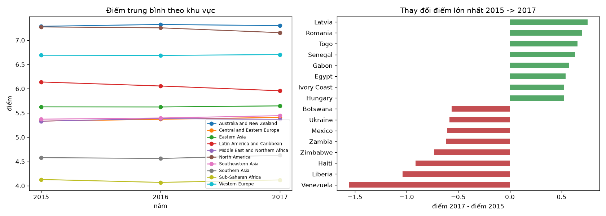
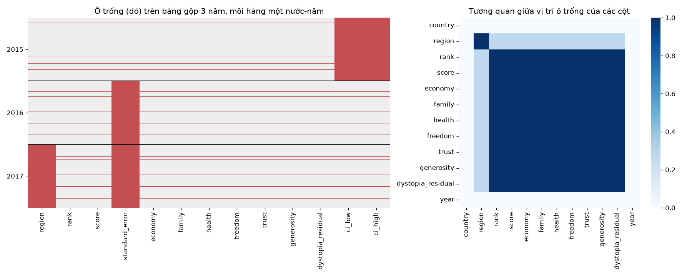

# Báo cáo bài 07: World Happiness 2015–2017

Mọi con số dưới đây do `solution/analyze.py` in ra. Hình nằm ở [figures/](figures/), bảng ở [results/](results/).

```
solution/happiness.py   đọc, chuẩn hoá tên cột và tên nước, điền region, gộp 3 năm (có test)
solution/analyze.py     trả lời 10 câu hỏi, mỗi câu một hàm q1…q9
```

## 0. Làm sạch trước khi phân tích

Mở 3 file ra là thấy ngay 4 vấn đề cần xử lý trước khi phân tích:

| Vấn đề | Cách xử lý |
|---|---|
| Tên cột mỗi năm một kiểu: `Happiness Score` và `Happiness.Score`, `Economy (GDP per Capita)` và `Economy..GDP.per.Capita.` | Một bảng `RENAME` đưa mọi cột về snake_case chung. Gặp cột lạ thì báo lỗi, không lặng lẽ bỏ qua. |
| File 2017 không có cột `Region` | `fill_regions`: region của một nước không đổi theo năm, nên lấy từ năm khác. Sau bước này không còn nước nào thiếu region. |
| Cùng một nơi viết hai cách: `Somaliland region` (2015) và `Somaliland Region` (2016) | Gộp tên. Nhờ vậy mỗi file có 163 nước thay vì 164 dòng như ban đầu. |
| Mỗi file có 163–164 dòng nhưng chỉ 155–158 nước có số liệu | Xem câu 7–9. |

## Câu 1. Yếu tố đóng góp nhiều nhất vào điểm 2015

Chìa khoá của câu này là đọc ý nghĩa các cột. 6 cột yếu tố **không** phải số đo gốc (GDP tính bằng đô la, tuổi thọ tính bằng năm…). Chúng là **phần điểm** mà mỗi yếu tố giải thích được, và `score` đúng bằng tổng 6 yếu tố cộng `dystopia_residual`. Code kiểm tra lại điều này: sai lệch lớn nhất là 0,0005, chỉ do làm tròn.

Vì vậy "đóng góp" đo trực tiếp được bằng giá trị trung bình của từng cột:

| Thành phần | Đóng góp TB (điểm) | % của điểm TB | Tương quan với điểm |
|---|---|---|---|
| Phần dư Dystopia | 2,099 | 39,0% | 0,53 |
| **Gia đình** | **0,991** | **18,4%** | 0,74 |
| **Kinh tế (GDP)** | 0,846 | 15,7% | **0,78** |
| Sức khoẻ | 0,630 | 11,7% | 0,72 |
| Tự do | 0,429 | 8,0% | 0,57 |
| Sự hào phóng | 0,237 | 4,4% | 0,18 |
| Niềm tin | 0,143 | 2,7% | 0,40 |



**Kết luận.** Hai cách đo trả lời hai câu hỏi khác nhau:
- Xét **lượng điểm đóng góp**, *gia đình* lớn nhất (0,99 điểm), sau đó là kinh tế và sức khoẻ.
- Xét **khả năng phân biệt nước hạnh phúc với nước kém hạnh phúc** (tương quan), *kinh tế* mạnh nhất (0,78).

*Sự hào phóng* đóng góp ít, và hầu như không liên quan đến thứ hạng (0,18). Gần 40% điểm nằm ở phần dư, tức phần 6 yếu tố không giải thích được.

## Câu 2. Gộp nhóm cho thấy gì

| Khu vực | Số nước | TB | Trung vị | Độ lệch chuẩn | Thấp nhất | Cao nhất |
|---|---|---|---|---|---|---|
| Australia and New Zealand | 2 | 7,29 | 7,29 | 0,00 | 7,28 | 7,29 |
| North America | 2 | 7,27 | 7,27 | 0,22 | 7,12 | 7,43 |
| Western Europe | 21 | 6,69 | 6,94 | 0,83 | 4,86 | 7,59 |
| Latin America and Caribbean | 22 | 6,15 | 6,15 | 0,73 | 4,52 | 7,23 |
| Eastern Asia | 6 | 5,63 | 5,73 | 0,55 | 4,87 | 6,30 |
| Middle East and Northern Africa | 20 | 5,41 | 5,26 | **1,10** | 3,01 | 7,28 |
| Central and Eastern Europe | 29 | 5,33 | 5,29 | 0,57 | 4,22 | 6,51 |
| Southeastern Asia | 9 | 5,32 | 5,36 | 0,95 | 3,82 | 6,80 |
| Southern Asia | 7 | 4,58 | 4,57 | 0,57 | 3,58 | 5,25 |
| Sub-Saharan Africa | 40 | 4,20 | 4,27 | 0,61 | 2,84 | 5,48 |



Gộp nhóm cho thấy những điều mà bảng 158 dòng không cho thấy:
- **Khoảng cách giữa các khu vực rất lớn.** Châu Phi cận Sahara thấp hơn Bắc Âu/Úc khoảng 3 điểm, trên thang 10.
- **Độ phân tán trong từng khu vực.** Trung Đông–Bắc Phi trải từ 3,0 (Syria) đến 7,3 (Israel), độ lệch chuẩn 1,10. Ở khu vực này, "trung bình" gần như không đại diện cho nước nào. Ngược lại, Trung–Đông Âu đồng đều hơn hẳn.
- **Trung bình và trung vị.** Ở Tây Âu, trung vị 6,94 cao hơn trung bình 6,69, vì vài nước như Hy Lạp (4,86) kéo trung bình xuống. Trung vị ít bị ảnh hưởng bởi giá trị ngoại lai.
- **Cấu trúc điểm** (hình phải). Khoảng cách giữa các khu vực chủ yếu đến từ *kinh tế* và *sức khoẻ*: châu Phi cận Sahara chỉ có 0,38 và 0,28, so với khoảng 1,3 và 0,9 ở Tây Âu. *Gia đình* thì đồng đều hơn nhiều giữa các khu vực.
- **Cẩn thận với nhóm nhỏ.** Úc–New Zealand và Bắc Mỹ chỉ có 2 nước mỗi khu vực, không đủ để rút ra kết luận thống kê.

## Câu 3. Khu vực so với thế giới

Trung bình thế giới là **5,376**, tính theo mỗi nước một phiếu. Lấy trung bình cộng của 10 khu vực lại ra **5,786**. Lý do: Úc–New Zealand (2 nước) và châu Phi cận Sahara (40 nước) được tính ngang nhau. Muốn ra trung bình thế giới từ trung bình khu vực thì phải **có trọng số** theo số nước. Đây là lỗi hay gặp khi lấy trung bình của các giá trị trung bình.

Chênh lệch so với thế giới: từ +1,91 (Úc–NZ) đến −1,17 (châu Phi cận Sahara). Ba khu vực Trung Đông–Bắc Phi, Trung–Đông Âu và Đông Nam Á đều nằm sát mức trung bình (trong khoảng ±0,06).

**Các yếu tố quan trọng có giống nhau ở mọi nơi không? Không.** Tương quan giữa từng yếu tố và điểm, tính trong các khu vực có ít nhất 8 nước:

| | Kinh tế | Gia đình | Sức khoẻ | Tự do | Niềm tin | Hào phóng |
|---|---|---|---|---|---|---|
| **Thế giới** | 0,78 | 0,74 | 0,72 | 0,57 | 0,40 | 0,18 |
| Western Europe | 0,72 | 0,82 | **0,01** | 0,82 | **0,82** | 0,56 |
| Sub-Saharan Africa | 0,35 | 0,58 | 0,05 | 0,10 | −0,08 | 0,29 |
| Southeastern Asia | **0,90** | 0,83 | 0,81 | −0,21 | 0,34 | −0,24 |
| Latin America and Caribbean | 0,73 | 0,49 | 0,65 | 0,39 | 0,13 | **−0,42** |



- Ở Tây Âu, *sức khoẻ* gần như không liên quan đến điểm (0,01), vì nước nào ở đó cũng có tuổi thọ cao. Thứ phân biệt các nước Tây Âu với nhau là *tự do* và *niềm tin vào chính phủ* (0,82).
- Ở châu Phi cận Sahara, mọi tương quan đều yếu. 6 yếu tố này giải thích kém sự khác biệt giữa các nước trong khu vực.
- Bài học chung: một yếu tố chỉ giải thích được sự khác biệt khi **nó thay đổi** trong nhóm đang xét. Tương quan trên toàn thế giới phần lớn đến từ khoảng cách *giữa* các khu vực.

## Câu 4. Các cách gộp DataFrame

Năm 2015 có 158 nước, 2016 có 157 nước, 152 nước có mặt cả hai năm.

| Cách | Kết quả | Dùng khi |
|---|---|---|
| `merge(how="inner")` | 152 dòng | chỉ cần các nước có ở cả hai bảng |
| `merge(how="left")` | 158 | giữ mọi dòng của bảng trái, bảng phải thiếu thì để NaN |
| `merge(how="right")` | 157 | ngược lại với `left` |
| `merge(how="outer")` | 163 | giữ mọi nước của cả hai bảng |
| `concat(axis=0)` | 315 | **xếp chồng** các bảng cùng cấu trúc (ví dụ các năm), không ghép theo khoá |
| `concat(axis=1)` | 163 | ghép **cạnh nhau** theo index (ở đây đặt `country` làm index), tương đương outer join |
| `DataFrame.join` | 158 | `merge` ghép theo index, mặc định `how="left"` |

`merge` và `join` *ghép theo khoá* (giống SQL JOIN), còn `concat` *xếp chồng*. Ngoài ra còn `combine_first`, dùng để vá ô trống của bảng này bằng giá trị của bảng kia, và `merge_asof`, dùng để ghép theo khoá gần nhất (ví dụ theo thời gian).

Lỗi thường gặp:
- `merge` khi khoá bị trùng làm số dòng tăng vọt. Có thể chặn bằng `validate="one_to_one"`.
- Quên rằng `inner` lặng lẽ bỏ dòng. Câu 6 cố ý dùng tập 148 nước có mặt đủ 3 năm để tránh vấn đề này.

## Câu 5. Gộp 3 năm

`combine()` chỉ giữ các cột chung (`country, region, year, rank, score`, 6 yếu tố và `dystopia_residual`) rồi `concat` theo dòng thành dạng dài: **470 dòng** (158 + 157 + 155), mỗi dòng là một cặp nước–năm. Kết quả lưu ở [results/happiness_2015_2017.csv](results/happiness_2015_2017.csv).

Chọn dạng **dài** thay vì dạng rộng (mỗi nước một dòng, có các cột `score_2015`, `score_2016`…) vì `groupby("year")`, `pivot_table` và vẽ biểu đồ đều làm việc tự nhiên với dạng dài. Khi cần thì đổi sang dạng rộng bằng một lệnh `pivot`, như ở câu 6.

Ba cột chỉ có ở một năm (`standard_error` của 2015, `ci_low`/`ci_high` của 2016 và 2017) bị loại khỏi bảng gộp. Chúng đo cùng một khái niệm (độ bất định của điểm) nhưng mỗi năm một cách, nên không so sánh trực tiếp được.

## Câu 6. Thay đổi từ 2015 đến 2017

Câu này chỉ so trên **148 nước có mặt đủ 3 năm**. Nếu so trên toàn bộ, thay đổi về điểm sẽ lẫn với thay đổi về danh sách nước.

| Năm | Điểm TB | Kinh tế | Gia đình | Sức khoẻ | Tự do |
|---|---|---|---|---|---|
| 2015 | 5,403 | 0,869 | 1,002 | 0,650 | 0,428 |
| 2016 | 5,392 | 0,972 | **0,803** | 0,569 | 0,368 |
| 2017 | 5,402 | 1,011 | **1,208** | 0,569 | 0,408 |



- **Trên toàn thế giới: gần như không đổi.** Điểm trung bình đổi −0,000; 75 nước tăng, 73 nước giảm.
- **Theo khu vực:** Mỹ Latinh giảm đều (6,14 → 5,96), Bắc Mỹ giảm nhẹ, các khu vực khác gần như đứng yên.
- **Từng nước** thì thay đổi lớn:
  - Venezuela giảm 1,56 điểm, trùng với khủng hoảng kinh tế; Liberia giảm 1,04, Haiti 0,92.
  - Latvia tăng 0,75, Romania tăng 0,70, Togo tăng 0,66.
  - Trung bình thế giới đứng yên che mất những thay đổi này.
- **Cảnh báo:** *gia đình* nhảy từ 1,00 xuống 0,80 rồi lên 1,21. Thế giới không thay đổi nhanh như vậy được. Nguyên nhân là mỗi năm báo cáo **ước lượng lại mô hình** chia điểm cho các yếu tố. Vì vậy so `score` giữa các năm thì được, còn so các cột yếu tố giữa các năm thì **không** đáng tin.

## Câu 7. Vị trí ô trống



Heatmap ghép 3 năm thành 489 dòng (163 nước × 3 năm). Có ba mảng đỏ:
- **Các khối lớn theo cột:** `standard_error` trống ở 2016–2017, `ci_low`/`ci_high` trống ở 2015, `region` trống ở cả năm 2017. Đây là **cột không tồn tại** trong năm đó, không phải số liệu bị mất.
- **Các vạch ngang mảnh:** 19 dòng trống *toàn bộ* các cột số cùng lúc.
- **Hình phải:** vị trí ô trống của `rank`, `score` và 6 yếu tố tương quan 1,0 với nhau. Chúng luôn thiếu cùng nhau, chứ không bao giờ thiếu lẻ một ô.

## Câu 8. Ảnh hưởng của việc xoá hoặc điền

**a. Bao nhiêu phần trăm bị thiếu?** Con số phụ thuộc vào cách đếm:

| Cách đếm | Tỷ lệ |
|---|---|
| Toàn bảng gộp, tính cả cột chỉ có ở một năm | 14,0% |
| Chỉ tính các cột chung | 5,9% |
| `score` và 6 yếu tố | 3,9% (19 / 489 dòng) |
| `region` trước khi điền | 35,6%, sau khi điền từ năm khác còn 0% |

**b. Xoá có làm mất thông tin ở cột khác không?**
- **Xoá 19 dòng thiếu `score`: không mất gì.** Ngoài tên nước và năm, các dòng đó không có giá trị nào khác (số ô có giá trị: 0).
- **Gọi `dropna()` thẳng trên bảng gộp thì mất 100% dữ liệu: còn 0/489 dòng.** Dòng nào cũng thiếu ít nhất một cột chỉ có ở năm khác. Đây là ví dụ rõ nhất cho việc phải hiểu *vì sao* dữ liệu thiếu trước khi xử lý.

**Ảnh hưởng tới phân tích.** Xoá dòng không làm mất thông tin, nhưng làm **lệch mẫu**:
- 12 trong 19 dòng thiếu (63%) thuộc châu Phi cận Sahara, trong khi khu vực này chỉ chiếm 26% bảng.
- Những nước "lúc có lúc không" có điểm trung bình 4,89 ở các năm có mặt, thấp hơn mức chung 5,37.

Hệ quả: trung bình thế giới của một năm bị đẩy lên nhẹ nếu năm đó thiếu nhiều nước nghèo. Đây là lý do câu 6 chỉ so trên 148 nước có đủ 3 năm.

## Câu 9. Quy luật của dữ liệu thiếu

Có quy luật rõ ràng: dữ liệu thiếu **theo cả dòng**, đúng ở những nước **không được khảo sát** năm đó.

| Năm | Nước không có số liệu |
|---|---|
| 2015 | Belize, Namibia, Puerto Rico, Somalia, South Sudan |
| 2016 | Central African Republic, Djibouti, Lesotho, Mozambique, Oman, Swaziland |
| 2017 | Comoros, Djibouti, Laos, Oman, Puerto Rico, Somaliland Region, Suriname, Swaziland |

Bộ dữ liệu gốc không có các dòng này. Các dòng trống được tạo ra khi ai đó lấy hợp tất cả tên nước của 3 năm để file nào cũng đủ 163–164 dòng. Theo cách phân loại thống kê, đây là dữ liệu **thiếu không ngẫu nhiên** (MNAR): khả năng một nước bị thiếu liên quan tới chính tình trạng của nước đó (nước nghèo, xung đột, khó khảo sát).

## Câu 10. Chọn cách điền giá trị thiếu

### Các phương pháp

| Phương pháp | Ưu điểm | Nhược điểm |
|---|---|---|
| **Xoá dòng** (`dropna`) | đơn giản, không bịa ra số | mất mẫu; lệch mẫu nếu thiếu không ngẫu nhiên; xoá nhầm cả bảng nếu không chọn `subset` |
| **Xoá cột** | hợp với cột trống gần hết hoặc không dùng tới | mất cả biến |
| **Hằng số / giá trị trung bình / trung vị** | nhanh, giữ đủ số dòng | thu hẹp phương sai, làm yếu tương quan; trung bình bị ảnh hưởng bởi giá trị ngoại lai (trung vị thì không) |
| **Trung bình theo nhóm** (ví dụ theo khu vực) | sát thực tế hơn trung bình chung | vẫn thu hẹp phương sai; nhóm nhỏ thì không ổn định |
| **Giá trị phổ biến nhất** (mode) | dùng được cho cột phân loại | dồn về một nhóm |
| **Lấy từ năm khác của cùng nước** (`ffill`/`bfill`, nội suy) | tận dụng tính liên tục theo thời gian | chỉ hợp với dữ liệu thay đổi chậm; giả định không có biến động |
| **Theo quan hệ đã biết** (tra bảng, công thức) | chính xác tuyệt đối | chỉ áp dụng khi giá trị được xác định bởi cột khác |
| **Mô hình** (KNN, hồi quy, `IterativeImputer`) | dùng được thông tin của nhiều cột | phức tạp; có thể rò rỉ thông tin trong ML; vô dụng khi cả dòng đều trống |
| **Giữ NaN + thêm cột cờ `is_missing`** | không mất thông tin "bị thiếu" | công cụ phía sau phải xử lý được NaN |

### Chọn cho từng cột

| Cột | Cách chọn | Lý do |
|---|---|---|
| `region` | **lấy theo `country` từ năm khác** | region được xác định hoàn toàn bởi nước, nên điền chính xác 100%, không phải đoán |
| `score`, `rank`, 6 yếu tố, `dystopia_residual` | **xoá dòng nước–năm đó** (`dropna(subset=["score"])`) | cả dòng trống, nên không có cột nào để dự đoán từ đó. Điền trung bình sẽ biến Somalia thành một nước "trung bình thế giới", sai hoàn toàn và sai có hệ thống (MNAR). Muốn so theo thời gian thì dùng tập nước có đủ các năm. |
| `score` khi bắt buộc phải có chuỗi liên tục (ví dụ vẽ đường xu hướng cho một nước) | nội suy từ năm liền kề **và thêm cột cờ** | chấp nhận được với 1 năm bị khuyết ở giữa (ví dụ Central African Republic có 2015 và 2017); không được ngoại suy ra ngoài khoảng có dữ liệu |
| `standard_error`, `ci_low`, `ci_high` | **bỏ cột** khỏi bảng gộp, giữ ở bảng từng năm | là cột riêng của từng năm, mỗi năm đo một kiểu; điền là bịa số |

**Nguyên tắc chung rút ra:** trước khi điền, hỏi *vì sao* ô này trống.
- Không có cột này trong năm đó: xử lý ở **mức cột**.
- Giá trị suy ra được từ cột khác: **tra cứu**.
- Không có thông tin nào: **đừng bịa**. Xoá dòng và ghi lại rằng mẫu đã bị lệch.

## So với bản cũ

Bản cũ có phần lý thuyết về dữ liệu thiếu khá đầy đủ (MCAR, MAR, MNAR, KNN, `IterativeImputer`) và cũng điền `region` theo nước, giống bản mới. Khác biệt chính:

| Bản cũ | Bản mới |
|---|---|
| Notebook dài, logic làm sạch rải rác trong các cell | Module `happiness.py` có test, một bảng `RENAME` duy nhất; script sinh lại toàn bộ hình và bảng |
| Không phát hiện `Somaliland region` và `Somaliland Region` là một | Chuẩn hoá tên, mỗi năm 163 nước |
| Đề xuất điền `Happiness Score` bằng mô hình (`IterativeImputer`) | Chỉ ra rằng các dòng thiếu trống **toàn bộ**: mô hình không có gì để dựa vào và sẽ cho ra một giá trị gần trung bình thế giới, sai có hệ thống vì đây là MNAR. Xoá dòng và nêu rõ việc mẫu bị lệch. |
| So sánh giữa các năm trên toàn bộ dòng | Chỉ so trên 148 nước có đủ 3 năm; cảnh báo các cột yếu tố không so được giữa các năm |
| Câu 3 so sánh trung bình khu vực với trung bình thế giới | Thêm tương quan yếu tố–điểm trong từng khu vực, cho thấy các yếu tố quan trọng khác nhau giữa các khu vực |
