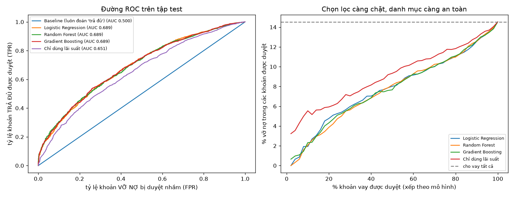
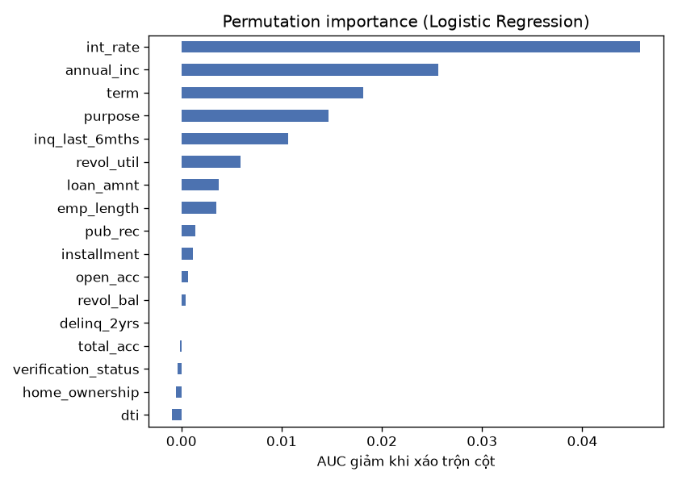

# Lời giải bài 08

```
solution/loans.py          chọn nhãn, bỏ cột (có lý do cho từng nhóm), làm sạch; có test
solution/train.py          pipeline sklearn, cross-validation, đánh giá trên test, bảng danh mục, hình
solution/leakage_demo.py   cho thấy cột rò rỉ làm AUC tăng vọt từ 0,67 lên 0,998
```

## Kết quả

| Mô hình | ROC AUC (CV 5-fold, tập train) | ROC AUC (tập test) |
|---|---|---|
| Luôn đoán "trả đủ" | 0,500 | 0,500 |
| Chỉ xếp theo lãi suất | | 0,651 |
| **Logistic Regression** | **0,712** ± 0,011 | 0,689 |
| Random Forest | 0,709 ± 0,015 | 0,689 |
| Gradient Boosting | 0,709 ± 0,012 | 0,689 |

Danh mục nếu nhà đầu tư chỉ cho vay x% khoản vay được mô hình (Logistic Regression) đánh giá tốt nhất, trên 7 757 khoản của tập test:

| Cho vay | Số khoản | **Tỷ lệ vỡ nợ** | Lãi suất TB | *Nếu chỉ xếp theo lãi suất: vỡ nợ / lãi suất* |
|---|---|---|---|---|
| 10% | 776 | **1,9%** | 7,4% | 5,5% / 6,3% |
| 25% | 1 939 | **5,4%** | 8,3% | 6,3% / 7,3% |
| 50% | 3 878 | **8,0%** | 9,6% | 9,3% / 9,0% |
| 75% | 5 818 | 10,5% | 10,7% | 11,6% / 10,4% |
| 100% | 7 757 | 14,5% | 12,0% | 14,5% / 12,0% |



**Đọc kết quả thế nào:**
- Cho vay tất cả thì 14,5% khoản vay vỡ nợ. Chỉ chọn 10% khoản tốt nhất theo mô hình thì tỷ lệ vỡ nợ còn **1,9%**, giảm khoảng 7,5 lần.
- So với cách chọn đơn giản là "chỉ cho vay lãi suất thấp nhất" (5,5%), mô hình vẫn giảm được gần 3 lần. Mô hình thật sự học được thông tin mà lãi suất chưa có.
- Cái giá phải trả: danh mục càng an toàn thì lãi suất càng thấp, vì LendingClub đặt lãi suất cao cho khoản rủi ro. Chọn mức nào là **quyết định kinh doanh** (đánh đổi lợi nhuận và rủi ro). Mô hình chỉ cung cấp đường đánh đổi ở hình phải.
- AUC khoảng 0,69 là mức thực tế với bộ dữ liệu này. Có thông tin quan trọng không nằm trong dữ liệu, ví dụ người vay mất việc sau khi vay, nên không mô hình nào dự đoán gần hoàn hảo được, **trừ khi có rò rỉ** (xem mục 2).

## 1. Chọn nhãn và loại cột

**Nhãn.** Chỉ giữ hai trạng thái `Fully Paid` (33 148 khoản) và `Charged Off` (5 634 khoản). Các trạng thái khác bị bỏ:
- `Current`, `Late…`, `In Grace Period`: khoản vay **chưa kết thúc**, chưa biết kết cục.
- `Does not meet the credit policy…`: khoản vay theo chính sách xét duyệt cũ, không còn được cấp. Nhà đầu tư ngày nay không gặp loại khoản này.

**Cột bị bỏ** (`loans.py`, mỗi nhóm một hằng số):

| Nhóm | Cột | Lý do |
|---|---|---|
| `LEAKAGE` | `total_pymnt`, `total_rec_prncp`, `recoveries`, `last_pymnt_d`, `funded_amnt`, `issue_d`… | chỉ biết **sau** khi đã cho vay |
| `IDENTIFIERS` | `id`, `member_id`, `url` | ngẫu nhiên, không liên quan khả năng trả nợ |
| `REDUNDANT` | `grade`, `sub_grade`, `title` | LendingClub suy ra `int_rate` từ `grade`; `title` là chữ tự do, trùng ý với `purpose` |
| `NEEDS_WORK` | `emp_title`, `zip_code`, `earliest_cr_line`, `desc`, `pub_rec_bankruptcies` | cần xử lý chữ, ngày tháng, hoặc nguồn dữ liệu khác mới dùng được |
| `HIGH_CARDINALITY` | `addr_state` | 51 giá trị nên dễ học vẹt; vùng miền còn là biến nhạy cảm về công bằng khi xét cho vay |
| tự động | 9 cột chỉ có một giá trị (`pymnt_plan`, `policy_code`, `application_type`…) | không phân biệt được gì |

Còn lại **17 đặc trưng**: số tiền vay, kỳ hạn, lãi suất, số tiền trả mỗi kỳ, thâm niên làm việc, sở hữu nhà, thu nhập, xác minh thu nhập, mục đích vay, tỷ lệ nợ trên thu nhập, và 7 chỉ số lịch sử tín dụng.

## 2. Rò rỉ dữ liệu: lỗi nguy hiểm nhất

`leakage_demo.py` đo hai việc:

```
Quy tắc 'đã trả đủ gốc' (total_rec_prncp >= loan_amnt) khớp nhãn 96.2%
4 cột biết trước khi cho vay   ROC AUC 0.667
+ 3 cột rò rỉ                  ROC AUC 0.998
```

`total_rec_prncp` là số tiền gốc **đã trả**. Biết cột này tức là đã biết kết cục, không cần mô hình nào cả. Một mô hình đạt AUC 0,998 trên giấy sẽ **vô dụng** khi triển khai, vì tại thời điểm quyết định cho vay, cột đó chưa tồn tại.

Rò rỉ còn xuất hiện ở dạng kín đáo hơn: các bước **học từ dữ liệu** (tính median để điền giá trị thiếu, tính mean/std để chuẩn hoá, sinh mẫu bằng SMOTE, chọn đặc trưng) mà chạy trên toàn bộ dữ liệu *trước* khi tách train/test. Mục 3 xử lý loại rò rỉ này.

## 3. Pipeline và cách đánh giá

```python
make_pipeline(
    ColumnTransformer([
        ("num", make_pipeline(SimpleImputer(strategy="median", add_indicator=True), StandardScaler()), numeric),
        ("log", make_pipeline(SimpleImputer(strategy="median"), FunctionTransformer(np.log1p), StandardScaler()), SKEWED),
        ("cat", OneHotEncoder(handle_unknown="ignore"), CATEGORICAL),
    ]),
    LogisticRegression(class_weight="balanced", max_iter=2000),
)
```

- **Mọi bước tiền xử lý nằm trong pipeline.** Khi `cross_val_score` chạy fold k, imputer và scaler chỉ học từ phần train của fold đó. Không có thông tin nào từ phần đánh giá lọt vào.
- **Điền giá trị thiếu.** `emp_length` thiếu 2,7%, `revol_util` thiếu 0,1%. Điền bằng median, và `add_indicator=True` thêm cột cờ "bị thiếu": việc người vay không khai thâm niên có thể tự nó là một tín hiệu.
- **Lấy log.** `annual_inc` (từ 4 000 đến 6 000 000) và `revol_bal` lệch phải rất mạnh, nên lấy log trước khi chuẩn hoá cho mô hình tuyến tính. Mô hình cây không cần bước này, vì cây chỉ quan tâm thứ tự giá trị.
- **Dữ liệu lệch lớp.** Dùng `class_weight="balanced"`: phạt lỗi ở lớp thiểu số nặng hơn, không sinh thêm dữ liệu giả. Đây là cách đơn giản nhất và không có nguy cơ rò rỉ như SMOTE.
- **Thước đo.** Mô hình "luôn đoán trả đủ" đã đạt accuracy 85,5%, nên accuracy không nói lên gì. **ROC AUC** đo khả năng *xếp hạng*: xác suất một khoản trả đủ được chấm điểm cao hơn một khoản vỡ nợ chọn ngẫu nhiên. Đó đúng là thứ nhà đầu tư cần, vì họ chọn top x%. Bảng danh mục chuyển AUC thành ngôn ngữ của nhà đầu tư.
- **Quy trình.** Tách 20% làm tập test (`stratify=y` để giữ tỷ lệ 85/15). Chọn mô hình bằng CV 5-fold trên 80% còn lại. Tập test chỉ được dùng **một lần** ở cuối.

**Chọn mô hình.** Ba mô hình gần như ngang nhau (AUC chênh dưới 0,005, nhỏ hơn độ lệch giữa các fold). Chọn **Logistic Regression** vì đơn giản nhất, nhanh nhất, dễ giải thích từng hệ số, và ít overfit. Khi mô hình phức tạp không thắng rõ ràng thì chọn mô hình đơn giản.

AUC trên test (0,689) thấp hơn CV (0,712) một chút. Chênh lệch này nằm trong khoảng dao động giữa các fold (±0,011–0,015) và là dấu hiệu bình thường.

## 4. Đặc trưng quan trọng

Đo bằng **permutation importance** trên tập test: xáo trộn một cột rồi xem AUC giảm bao nhiêu. Cách này áp dụng được cho mọi mô hình, và đo trên dữ liệu mô hình chưa thấy.



| Đặc trưng | AUC giảm |
|---|---|
| `int_rate` | 0,046 |
| `annual_inc` | 0,026 |
| `term` (60 tháng rủi ro hơn 36) | 0,018 |
| `purpose` | 0,015 |
| `inq_last_6mths` (số lần hỏi vay gần đây) | 0,011 |

Lãi suất mạnh nhất, vì nó tóm tắt đánh giá rủi ro của chính LendingClub. Nhưng mốc "chỉ xếp theo lãi suất" ở bảng kết quả cho thấy thu nhập, kỳ hạn, mục đích vay và hành vi hỏi vay còn mang thêm thông tin.

## 5. Có thể làm tiếp

- **Đánh giá theo thời gian.** Train trên khoản vay 2007–2010, test trên 2011. Cách này sát thực tế hơn tách ngẫu nhiên, vì ngoài đời mô hình luôn dự đoán cho các khoản vay *tương lai*.
- **Tối ưu lợi nhuận thay vì tỷ lệ vỡ nợ.** Dùng `int_rate`, `term` và số tiền thu hồi để tính lợi nhuận kỳ vọng của từng khoản, rồi chọn danh mục tối đa hoá lợi nhuận với mức rủi ro chấp nhận được.
- **Hiệu chỉnh xác suất** (`CalibratedClassifierCV`), khi cần dùng xác suất dự đoán như một con số thật (ví dụ "70% trả đủ").

## So với bản cũ

| Bản cũ | Bản mới |
|---|---|
| `RobustScaler` và chọn đặc trưng chạy trên **toàn bộ** dữ liệu trước khi tách train/test | Mọi bước học từ dữ liệu nằm trong pipeline, chỉ học trên phần train |
| SMOTE trên tập train, rồi **tách tiếp tập đã SMOTE** để đánh giá, nên báo ROC AUC **0,936** (Random Forest) | Đánh giá trên dữ liệu thật chưa qua resample. Chính notebook cũ, khi đo trên tập test thật ở phần monitoring, cũng chỉ đạt **0,684**: con số 0,936 là ảo |
| Báo cáo accuracy, precision, recall ở ngưỡng 0,5 | ROC AUC cộng bảng danh mục theo % khoản được duyệt, đúng câu hỏi của nhà đầu tư |
| Mốc so sánh là Logistic Regression | Thêm hai mốc đơn giản hơn: "luôn đoán trả đủ" và "chỉ xếp theo lãi suất". Mốc thứ hai cho biết mô hình có học thêm được gì ngoài đánh giá rủi ro sẵn có của LendingClub |
| Chuẩn hoá chữ hoa/thường cho `verification_status`, `home_ownership`, `purpose` | Chuẩn hoá mọi cột chữ (cả khoảng trắng thừa) **trước** khi tìm cột hằng số, nhờ vậy phát hiện `application_type` thực ra chỉ có một giá trị |
| Lưu `processed_loans.csv` và model `.pkl` (16 MB) | Không lưu sản phẩm trung gian; chạy lại toàn bộ trong khoảng 15 giây |
