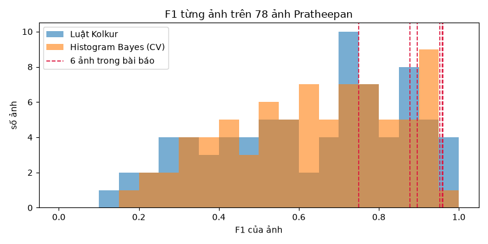
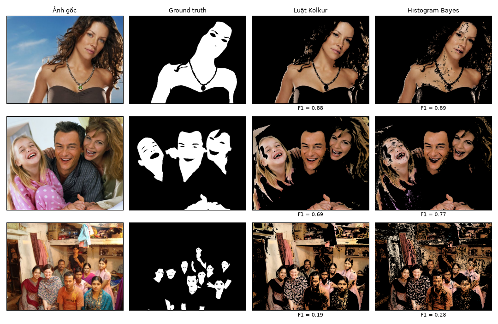
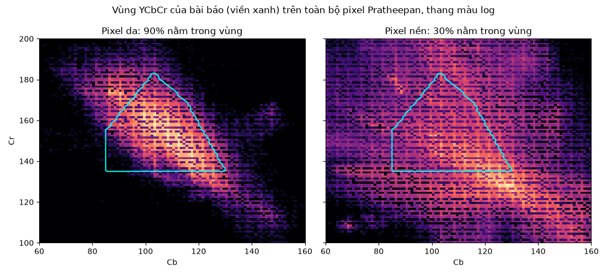

# Lời giải bài 09

```
data/download.py             tải Pratheepan từ nguồn chính thức, kiểm tra SHA-256
solution/skin.py             đổi hệ màu và các luật ngưỡng, vector hoá bằng numpy
solution/metrics.py          ma trận nhầm lẫn: so từng pixel, và cách "so số lượng" của bài báo
solution/dataset.py          đọc ảnh và mask; danh sách 6 ảnh trong bảng 1 của bài báo
solution/histogram_bayes.py  mốc so sánh học từ dữ liệu (Jones & Rehg 2002)
solution/evaluate.py         chạy mọi thứ, ghi results/*.csv và figures/*.png
```

## Tóm tắt

| | Bài báo công bố | Kiểm chứng lại |
|---|---|---|
| Dữ liệu | 6 ảnh tự chọn | 6 ảnh đó, rồi toàn bộ 78 ảnh |
| Accuracy | 94,4% | 94,9% trên 6 ảnh, **81,8%** trên 78 ảnh. Đoán "không có da ở đâu cả" đã đạt 83,2% |
| Precision | 89,3% | 84,8% trên 6 ảnh, **47,5%** trên 78 ảnh |
| Cách tính TP/FP | không nói | chỉ so **số lượng** pixel da, không so vị trí |

Kết luận: luật ngưỡng chạy được và có ích như một bước lọc thô, nhưng con số trong bài báo vừa đến từ cách đo sai, vừa đến từ việc chọn ảnh dễ. 6 ảnh trong bài đứng hạng **2, 3, 4, 10, 15, 28** trên 78 ảnh khi xếp theo F1.

## 1. Bài toán

**Phát hiện da theo từng pixel:** đầu vào là một ảnh màu, đầu ra là một mask nhị phân, mỗi pixel là "da" hoặc "không phải da". Bài báo chỉ dùng **màu của chính pixel đó**, không nhìn hàng xóm, hình dạng hay ngữ cảnh.

Ứng dụng: bước tiền xử lý để khoanh vùng có thể là mặt hoặc tay (cho nhận diện khuôn mặt, theo dõi cử chỉ), lọc ảnh nhạy cảm, và theo tác giả là chẩn đoán bệnh da. Ưu điểm của cách chỉ dùng màu là rất nhanh và không phụ thuộc hướng hay kích thước vật thể.

## 2. Kết quả bài báo công bố

- Bảng 1: 6 ảnh của bộ Pratheepan, mỗi ảnh có TP, FP, TN, FN, precision, accuracy. Bài báo báo trung bình **precision 89,33%, accuracy 94,43%**.
- Hình 5–6: ảnh kết quả, hình 7: số pixel da mà mỗi hệ màu phát hiện trên 3 ảnh.
- Không có so sánh với phương pháp nào khác, không có kết quả trên toàn bộ bộ dữ liệu.

Các con số trung bình cũng không khớp chính bảng 1: trung bình 6 hàng là precision 89,55% và accuracy 95,49%.

## 3. Phương pháp

Một pixel là da khi:

```
RGB  VÀ  (HSV  HOẶC  YCbCr)

RGB:   R > 95, G > 40, B > 20, R > G, R > B, |R − G| > 15, A > 15
HSV:   0° ≤ H ≤ 50°, 0,23 ≤ S ≤ 0,68
YCbCr: Cr > 135, Cb > 85, Y > 80, và Cr nằm trong 5 nửa mặt phẳng (một đa giác trên mặt phẳng Cb–Cr)
```

Toàn bộ là [skin.py](solution/skin.py). Mỗi luật là một biểu thức boolean trên cả mảng numpy, không có vòng lặp.

**Những chỗ bài báo mô tả chưa đúng, và cách hiểu đã chọn:**

| Bài báo viết | Vấn đề | Chọn |
|---|---|---|
| `Y = 0.299R + 0.287G + 0.11B`, `Cr = R − Y`, `Cb = B − Y` | Hệ số in sai (chuẩn là 0,587 và 0,114). Không có độ lệch 128, nên Cb, Cr có thể âm, trong khi ngưỡng `Cb > 85` và `Cr > 135` chỉ có nghĩa khi Cb, Cr quanh 128 | YCbCr chuẩn BT.601 dải đầy đủ (như JPEG, OpenCV), Cb và Cr lệch +128 |
| H từ 0 đến 50, S từ 0,23 đến 0,68 | Không nói đơn vị. Văn bản mục 3.3 dùng H theo độ, S trong [0, 1] | H theo độ, S trong [0, 1] |
| `A > 15` | Kênh alpha của ảnh JPEG luôn là 255 | Bỏ, vì luôn đúng |
| Bảng 1 | Không nói cách tính TP/FP | Xem mục 4.1 |

Lỗi thang đo dễ mắc nhất khi cài đặt bằng OpenCV: `cv2.cvtColor(img, cv2.COLOR_BGR2HSV)` với ảnh uint8 trả **H trong [0, 180) và S trong [0, 255]**. So `S` với 0,23..0,68 thì không pixel nào thoả, nên cả nhánh HSV bị tắt mà không báo lỗi gì. Hàm `rgb_to_hsv` tự tính đúng thang của bài báo, và có test so với `colorsys` của thư viện chuẩn.

## 4. Cài đặt và kiểm chứng

Tốc độ: khoảng **21 ms mỗi megapixel**, nhanh hơn khoảng **90 lần** so với duyệt từng pixel bằng vòng lặp Python (đo trên cùng một ảnh).

### 4.1 Bảng 1 được tính bằng cách đếm, không phải so từng pixel

Nhìn kỹ bảng 1, mọi hàng đều thoả:

```
TP = min(số pixel da phát hiện, số pixel da trong GT)
FP = phát hiện − TP          FN = GT − TP
```

Nghĩa là mỗi hàng chỉ có FP **hoặc** FN, không bao giờ cả hai. Tác giả chỉ so **diện tích** vùng da, không so **vị trí**. `test_paper_table_is_count_based` kiểm tra điều này trên cả 6 hàng.

Cách đo này sai: một mask đoán da ở toàn bộ nền và bỏ sót toàn bộ người, chỉ cần cùng diện tích, vẫn đạt precision và accuracy 100% (`test_shifted_mask_same_count_scores_perfect_in_paper_method`).

### 4.2 Chạy lại 6 ảnh của bài báo, đo đúng từng pixel

6 ảnh được tìm ra trong bộ dữ liệu bằng cách khớp kích thước và số pixel da trong ground truth với bảng 1 (5/6 khớp chính xác; ảnh 6 lệch vì ngưỡng nhị phân hoá mask).

| Ảnh | Pixel da phát hiện (bài báo) | (cài đặt này) | Accuracy bài báo | Accuracy từng pixel | Precision | Recall |
|---|---|---|---|---|---|---|
| 1 | 54 885 | 59 895 | 99,5% | 92,8% | 84,8% | 91,0% |
| 2 | 29 828 | 34 114 | 96,1% | 91,9% | 62,9% | 92,9% |
| 3 | 20 497 | 23 990 | 99,4% | 95,9% | 84,3% | 95,7% |
| 4 | 51 191 | 53 786 | 98,3% | 95,5% | 91,4% | 99,4% |
| 5 | 19 328 | 20 036 | 99,1% | 96,9% | 93,3% | 98,8% |
| 6 | 72 237 | 56 619 | 80,55% | 96,5% | 92,3% | 99,7% |

- Số pixel da phát hiện lệch bài báo 4–22%. Không thể khớp tuyệt đối, vì bài báo không cho đủ thông tin (công thức đổi màu sai, không có code Java gốc). Đây là bài học về khả năng tái lập: một bài báo không công bố code và có công thức in sai thì không ai kiểm chứng chính xác được.
- Đo đúng từng pixel thì accuracy vẫn cao trên 6 ảnh này. Nhưng accuracy không nói nhiều khi phần lớn pixel là nền.

### 4.3 Toàn bộ 78 ảnh

Cộng dồn mọi pixel của 78 ảnh (18,8 triệu pixel, 16,8% là da):

| Phương pháp | Precision | Recall | F1 | IoU | Accuracy |
|---|---|---|---|---|---|
| Đoán "không có da" | | 0 | 0 | 0 | 0,832 |
| Chỉ RGB | 0,432 | 0,886 | 0,581 | 0,410 | 0,786 |
| Chỉ HSV | 0,388 | 0,801 | 0,523 | 0,354 | 0,755 |
| Chỉ YCbCr | 0,455 | 0,792 | 0,578 | 0,406 | 0,806 |
| RGB và HSV | 0,510 | 0,751 | 0,608 | 0,437 | 0,838 |
| RGB và YCbCr | 0,485 | 0,780 | 0,598 | 0,427 | 0,824 |
| **Kolkur: RGB và (HSV hoặc YCbCr)** | 0,475 | 0,853 | **0,611** | 0,440 | 0,818 |
| Histogram Bayes (5-fold CV theo ảnh) | 0,573 | 0,718 | **0,637** | 0,468 | 0,863 |



- **Kết quả không giữ được.** Precision giảm từ 89% xuống 48%: cứ 2 pixel bị gọi là da thì 1 pixel là nền (gỗ, tường, tóc, quần áo màu be). Accuracy trên toàn bộ dữ liệu còn **thấp hơn** việc đoán "không có da ở đâu cả".
- **Bài báo chọn ảnh dễ.** F1 trung vị của 78 ảnh là 0,69. Của 6 ảnh trong bài là 0,92.
- **Ảnh chân dung dễ hơn ảnh nhóm** (F1 0,69 so với 0,55): ảnh nhóm có nhiều nền màu ấm và người nhỏ.
- Phép kết hợp của bài báo chỉ nhỉnh hơn luật đơn lẻ tốt nhất 0,03 F1. Nhánh "HOẶC" tăng recall nhưng kéo precision xuống.



Hàng 1 là một ảnh trong bài báo, hàng 2 là ảnh có F1 trung vị, hàng 3 là một trong những ảnh kém nhất: luật nhận gần như mọi bề mặt màu nâu ấm trong phòng là da.

**Vì sao luật chỉ dựa vào màu có giới hạn:** hình dưới cho thấy vùng YCbCr của bài báo chứa 90% pixel da, nhưng cũng chứa 30% pixel nền. Nền nhiều gấp 5 lần da, nên 30% nền đó lấn át. Không có cách vẽ đa giác nào tách được hai phân bố chồng lên nhau như vậy, chỉ bằng màu của một pixel.



## 5. Bối cảnh: vì sao, kế thừa từ đâu, cái gì tốt hơn

**Vì sao chọn ngưỡng màu.** Rẻ, không cần dữ liệu huấn luyện, giải thích được từng điều kiện, chạy được trên phần cứng yếu. Ý tưởng kết hợp nhiều hệ màu dựa trên quan sát rằng mỗi hệ màu sai ở những chỗ khác nhau, nên kết hợp có thể bù cho nhau.

**Kế thừa từ đâu.** Bài báo gần như không có phần "mới":
- Luật RGB là luật "ánh sáng ban ngày đồng đều" của **Kovač, Peer & Solina (2003)**, được nhắc lại trong survey của **Vezhnevets et al. (2003)**, tài liệu [5] của bài báo. Bài báo bỏ điều kiện `max(R,G,B) − min(R,G,B) > 15`, nhưng điều kiện đó đã được suy ra từ `R > G`, `R > B` và `|R − G| > 15`.
- Khoảng HSV (H từ 0 đến 50°, S từ 0,23 đến 0,68) là của **Sobottka & Pitas (1996)**.
- Bài báo không ghi nguồn cho cả hai, và cũng không nói 5 đường thẳng trong YCbCr được tìm ra thế nào.
- Phần mới duy nhất là cách kết hợp `RGB và (HSV hoặc YCbCr)`, và mục 4.3 cho thấy nó chỉ nhỉnh hơn luật đơn lẻ một chút.

**Cái gì tốt hơn.**
- Ngay trong tài liệu tham khảo của bài báo, **Jones & Rehg (2002)** [8] đã chỉ ra rằng **học** phân bố màu từ dữ liệu có nhãn tốt hơn đặt ngưỡng bằng tay. [histogram_bayes.py](solution/histogram_bayes.py) cài đặt ý tưởng đó trong khoảng 40 dòng: đếm tần suất từng ô màu (32×32×32 ô RGB) ở pixel da và pixel nền, phân loại theo tỉ lệ hai tần suất, và chọn ngưỡng cho F1 cao nhất trên tập train.
  - Đánh giá công bằng: 5-fold cross-validation **chia theo ảnh**, nên mọi ảnh được dự đoán bởi một mô hình chưa từng thấy nó.
  - Kết quả: F1 0,637 so với 0,611, precision 0,57 so với 0,48. Thắng, nhưng không nhiều, vì cả hai cùng chỉ nhìn màu một pixel.
- Để vượt hẳn giới hạn đó cần dùng **ngữ cảnh không gian**: region growing, CRF, hoặc mạng phân đoạn ảnh (U-Net, DeepLab) học cả màu, kết cấu và hình dạng. Các mạng này cần nhiều dữ liệu hơn 78 ảnh, và mạnh hơn hẳn trên ảnh có nền màu da.

## Bài học khi đọc bài báo

1. **Kiểm tra cách đo trước khi tin con số.** Ở đây chỉ cần cộng thử các cột của bảng 1 là phát hiện TP được tính từ số lượng.
2. **Hỏi "trên dữ liệu nào".** 6 ảnh tự chọn không đại diện cho 78 ảnh.
3. **Luôn có mốc so sánh.** Một con số không có mốc thì không nói lên gì. Ở đây mốc tầm thường nhất ("không có da") đã có accuracy cao hơn.
4. **Ghi lại mọi chỗ phải tự diễn giải** (công thức YCbCr, đơn vị HSV). Đó chính là lý do kết quả không tái lập chính xác được.

## So với bản cũ

| Bản cũ | Bản mới |
|---|---|
| Dùng thẳng H, S của OpenCV (H trong [0, 180), S trong [0, 255]) rồi so với `0.23 ≤ S ≤ 0.68`: nhánh HSV **không bao giờ đúng**, nên thực chất chỉ chạy `RGB và YCbCr` (đã kiểm chứng: 0 pixel thoả nhánh HSV) | Tự đổi màu đúng thang của bài báo, có test |
| Vòng lặp Python qua từng pixel | Vector hoá, nhanh hơn khoảng 90 lần |
| Chỉ chạy trên 6 ảnh của bài báo | Chạy thêm toàn bộ 78 ảnh, theo nhóm, và so với các luật đơn lẻ |
| Không phát hiện bảng 1 tính bằng cách đếm | Chỉ ra và có test |
| Notebook `Find_boundary` thử tự tìm đường biên trong Cb–Cr bằng DBSCAN và RANSAC | Cùng hướng "học từ dữ liệu", nhưng dùng histogram Bayes: đơn giản hơn, có đánh giá chéo theo ảnh |
| Dữ liệu và kết quả lưu trên Drive | Script tải từ nguồn chính thức, kiểm tra checksum; repo chỉ giữ vài hình kết quả |
