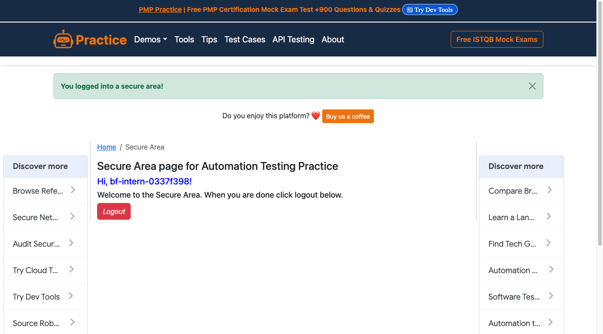

# Lời giải bài 10

```
solution/browser.py         mở và luôn đóng Chrome (context manager)
solution/books.py           A: 60 sản phẩm qua nhiều trang -> output/books.json
solution/cryptorefills.py   B: gift card của 3 nước đầu, giá theo 5 coin -> output/cryptorefills.json
solution/register_form.py   C: tự điền form đăng ký / đăng nhập, kiểm tra từng thông báo
tests/                      chạy offline trên HTML mẫu
```

## Nguyên tắc chung khi crawl

1. **Đọc `robots.txt` trước.** Cryptorefills cho phép crawl trang sản phẩm, cấm `/account`, `/payment`, `/cart`, và yêu cầu `Crawl-delay: 1`. Script giãn cách đúng 1 giây giữa các trang.
2. **Tìm dữ liệu có cấu trúc trước khi bấm vào giao diện:** `sitemap.xml` cho danh sách URL, khối JSON-LD (`<script type="application/ld+json">`) cho thông tin sản phẩm. Dữ liệu này dành cho máy đọc, nên ổn định hơn nhiều so với CSS class của giao diện (như `"relative mt-5"` trong code cũ), vốn đổi mỗi lần trang thiết kế lại.
3. **Chờ theo điều kiện, không `sleep` cố định.** `WebDriverWait(...).until(...)` chờ đúng tới khi phần tử xuất hiện. Nhanh hơn khi trang tải nhanh, và không lỗi khi trang tải chậm.
4. **Kiểm tra dữ liệu vừa lấy.** Mục B có ví dụ về một lỗi chỉ phát hiện được nhờ kiểm tra.
5. **Trang chặn bot thì dừng.** Không giả user-agent, không giấu dấu hiệu tự động hoá, không giải captcha.

## A. Danh sách sản phẩm

### Vì sao không dùng wine-searcher.com

```
curl  https://www.wine-searcher.com/discover?...   -> 403
Chrome (Selenium, headless)                       -> "Access to this page has been denied.
                                                      Nhấn và giữ để xác nhận bạn là người"
```

Trang dùng **PerimeterX**, một dịch vụ chống bot: nó chấm điểm từng request theo hành vi trình duyệt, và bắt làm thử thách "nhấn và giữ" khi nghi là bot. Có thể tìm cách vượt qua (giả trình duyệt thật, dùng proxy dân cư, giải thử thách), nhưng:
- Chủ trang đã trả tiền để nói rõ **"không muốn bị crawl tự động"**. Vượt qua là làm trái ý đó, và thường vi phạm điều khoản sử dụng.
- Đó là cuộc chạy đua không có điểm dừng: hàng rào được cập nhật liên tục, code vượt rào hôm nay mai sẽ hỏng.
- Muốn có dữ liệu giá rượu, cách đúng là liên hệ xin phép hoặc dùng API thương mại của chính trang (wine-searcher có bán dữ liệu cho doanh nghiệp).

Vì vậy phần A dùng [books.toscrape.com](https://books.toscrape.com/): trang được dựng riêng để luyện scraping, có cấu trúc của một cửa hàng thật (danh sách, phân trang, ảnh, giá, số sao, tình trạng kho).

### Cách làm ([books.py](solution/books.py))

- **Phân trang:** đi theo nút "next" cho tới khi đủ 60 sản phẩm. Không đoán URL `page-2.html`, `page-3.html`, vì quy tắc đặt tên có thể khác ở trang khác.
- **Tên đầy đủ** lấy ở thuộc tính `title`. Chữ hiển thị bị cắt bớt ("A Light in the ...").
- **URL ảnh tuyệt đối:** HTML ghi `../media/cache/...`, còn `get_attribute("src")` của Selenium trả URL đầy đủ.
- **Giá là số, kèm đơn vị tiền,** không phải chuỗi `"£51.77"`. `parse_price` phân biệt được dấu phân cách nghìn và dấu thập phân: `"1,299.00"` thành 1299, còn `"1.258.000 ₫"` (kiểu Việt Nam) thành 1 258 000. Dữ liệu vang cũ của bản trước có đúng dạng này.

Kết quả: 60 sản phẩm trong khoảng 9 giây, [output/books.json](output/books.json).

## B. Cryptorefills

### Ba nước đầu tiên

Code cũ có danh sách bắt đầu bằng Afghanistan, Åland Islands, Albania. Hiện tại trang `/en/afghanistan` trả 404 (Cryptorefills không còn bán ở đây) và không có trong sitemap. Ba nước đầu theo thứ tự chữ cái **hiện nay** là **Åland Islands, Albania, Algeria**: 38 gift card.

Thẻ nạp điện thoại (`mobile_top_up`) bị bỏ qua: cả 3 nước đều báo "không khả dụng", và loại này cần số điện thoại người nhận chứ không chọn mệnh giá như gift card.

### Ba bước

1. **Danh sách URL** từ `sitemap.xml`, lọc theo mẫu `/en/<nước>/gift_cards/<sản phẩm>`.
2. **Thông tin cố định** từ JSON-LD: `BreadcrumbList` cho quốc gia → danh mục → tên, `Product` cho tiêu đề, mô tả, ảnh, tình trạng kho. Sản phẩm hết hàng không có khối `Product`, nên lấy tạm từ thẻ `<h1>` và các thẻ `<meta>`.
3. **Giá theo coin** chỉ có sau khi JavaScript chạy và người dùng chọn coin, nên cần Selenium:
   - mở listbox `aria-label="Select Currency"`, chọn coin;
   - mở listbox `aria-label="Select Product"`, đọc mọi dòng dạng `"800 Robux\n0.00013559 BTC"`.

   Chọn phần tử theo `aria-label` (nhãn trợ năng): ổn định hơn class CSS, vì đổi nó sẽ làm hỏng trình đọc màn hình.

Không dùng giá trong JSON-LD: trang ghi `"priceCurrency": "USD"` cho cả thẻ Netflix mệnh giá **€75**, tức là dữ liệu có cấu trúc cũng có thể sai.

### Hai lỗi về thời điểm, và cách tìm ra

**Lỗi 1: listbox không đóng.** Gửi phím Escape vào `<body>` không có tác dụng, vì listbox chỉ nghe phím khi đang được focus. Mỗi coin vì vậy chờ hết 5 giây timeout. Lần chạy đầu bị dừng sau 15 phút mà chưa xong. Sửa: gửi Escape vào `driver.switch_to.active_element`.

**Lỗi 2: giá của coin cũ, đơn vị của coin mới.** Lần chạy thứ hai, mọi coin đều có **cùng một giá**, ví dụ "800 Robux: 10.30" cho cả BTC lẫn ETH. Phép kiểm tra "đơn vị trong danh sách khớp coin đã chọn" vẫn qua, nên lỗi không nằm ở việc chọn coin.

Tìm nguyên nhân:
1. Ghi lại nút giá mỗi 0,25 giây sau khi chọn BTC:
   ```
   t=0.0  114.88 BTC        <- số của USDT, đơn vị đã là BTC
   t=0.3  114.88 BTC
   t=0.5  0.00151072 BTC    <- giá thật
   ```
2. Bật performance log của Chrome để xem các request: mỗi lần đổi coin, trang gọi `GET /api/products/country/AL?brand_name=Roblox&...&coin=BTC`. Trong khoảng 0,5 giây chờ phản hồi, giao diện hiện **số cũ với đơn vị mới**.

Sửa: chờ tới khi **con số** trên nút giá đổi, chứ không chỉ chờ đơn vị đổi. Hai stablecoin USDT và USDC có thể trùng giá, nên chỉ chờ tối đa 3 giây. Sau khi đọc vẫn kiểm tra đơn vị của mọi dòng, sai thì bỏ coin đó và ghi log, không lưu dữ liệu sai.

Kiểm tra lại: 800 Robux = 0,00013559 BTC ≈ 10,3 USD = 10,30 USDT. Hợp lý.

**Bài học:** khi lấy dữ liệu từ giao diện động, "phần tử đã xuất hiện" chưa có nghĩa là "dữ liệu đã đúng". Luôn kiểm tra chéo dữ liệu vừa lấy.

### Kết quả

[output/cryptorefills.json](output/cryptorefills.json), chạy khoảng 5 phút:

| | Số sản phẩm |
|---|---|
| Có danh sách mệnh giá, đủ giá theo 5 coin | 18 (430 mức giá) |
| Nạp số tiền tuỳ ý (PayPal, Payz): chỉ ghi khoảng cho phép, ví dụ `2 - 1000` | 6 |
| Hết hàng: chỉ có thông tin cố định | 14 |

```json
{"country": "Albania", "category": "Games", "name": "Roblox", "title": "Roblox gift card",
 "redeem_area": "May only be redeemable in Albania", "in_stock": true,
 "prices": {"BTC":  [{"value": "800 Robux", "price": 0.00013559}, ...],
            "USDT": [{"value": "800 Robux", "price": 10.3}, ...]}}
```

Giá theo coin là **giá ước tính tại thời điểm crawl**, nên file ghi kèm `scraped_at`.

**Cách tốt hơn cho dự án thật:** request `/api/products/...` tìm được ở trên trả thẳng JSON. Dùng nó nhanh hơn và chính xác hơn bấm giao diện, nhưng đó là API **nội bộ, không có tài liệu**, có thể đổi bất cứ lúc nào. Cryptorefills có trang "API docs" chính thức (liên kết ở cuối trang web). Với một hệ thống chạy lâu dài, đó mới là nguồn nên dùng.

### Địa chỉ ví: giải thích, không cài đặt

Đề gốc yêu cầu 5 địa chỉ ví cho mỗi coin và mỗi mạng (BTC trên Mainnet, USDT trên Ethereum, Tron, Polygon...).

**Địa chỉ được tạo ra thế nào.** Trang sản phẩm không hiện địa chỉ ví nào. Địa chỉ nhận tiền chỉ xuất hiện ở bước **thanh toán**, sau khi đã tạo đơn hàng (chọn sản phẩm, nhập email, chọn coin và mạng). Các cổng thanh toán crypto thường cấp **một địa chỉ riêng cho mỗi đơn**, để biết khoản tiền nào thuộc đơn nào. Chính đề bài cũng ngầm xác nhận điều này: nếu địa chỉ cố định thì đã không cần hỏi "5 địa chỉ cho mỗi coin và mỗi mạng".

**Vì sao không tự động lấy:**
- Muốn 5 địa chỉ cho khoảng 25 coin × nhiều mạng, phải tạo **hàng trăm đơn hàng giả**. Việc này làm rác hệ thống đơn hàng của người bán, và có thể bị coi là lạm dụng.
- `robots.txt` cấm `/payment/` và `/cart/`.
- Dữ liệu thu được không dùng được vào việc gì: địa chỉ gắn với một đơn đã bỏ, không phải "ví của công ty".
- Code cũ đăng nhập bằng một tài khoản thật với **mật khẩu ghi thẳng trong code**, rồi thử bấm reCAPTCHA. Cả hai đều không nên làm: mật khẩu phải nằm trong biến môi trường hoặc trình quản lý bí mật, và captcha là tín hiệu "trang không muốn bot ở đây".

## C. Tự động điền form

Bài gốc là tự động tạo tài khoản trên một mạng xã hội hẹn hò. Tạo tài khoản hàng loạt và vượt captcha trên trang thật là lạm dụng nền tảng, vi phạm điều khoản sử dụng, và thường là bước đầu của spam hay lừa đảo. Vì vậy bài được đổi sang trang **dựng riêng để luyện kiểm thử tự động**. Kỹ năng Selenium học được vẫn y hệt: điền form, gửi, chờ, đọc thông báo, kiểm tra trạng thái đăng nhập.

[register_form.py](solution/register_form.py) chạy 10 bước, mỗi bước so với kết quả mong đợi:

```
OK  đăng ký bỏ trống mọi ô            -> /register  'All fields are required.'
OK  đăng ký tên quá ngắn              -> /register  'Username must be at least 3 characters long.'
OK  đăng ký tên có ký tự không hợp lệ -> /register  'Invalid username. Usernames can only contain lowercase letters, ...'
OK  đăng ký mật khẩu quá ngắn         -> /register  'Password must be at least 4 characters long.'
OK  đăng ký mật khẩu nhập lại không khớp -> /register  'Passwords do not match.'
OK  đăng ký hợp lệ                    -> /login     'Successfully registered, you can log in now.'
OK  đăng ký tên đã tồn tại            -> /register  'An error occurred during registration. Please try again.'
OK  đăng nhập sai mật khẩu            -> /login     'Your password is invalid!'
OK  đăng nhập đúng                    -> /secure    'You logged into a secure area!'
OK  đăng xuất rồi vào /secure         -> /login
10/10 bước đúng như mong đợi
```



- **Kiểm thử, không chỉ "chạy được":** mỗi trường hợp có URL và thông báo mong đợi, script thoát với mã khác 0 nếu có bước sai. Đây là cách viết test end-to-end.
- **`ElementClickInterceptedException`:** trên trang này, quảng cáo hay che nút Submit, nên `click()` báo lỗi "element click intercepted". Gửi form bằng phím Enter trong ô cuối, giống người dùng thật, thay vì dùng JavaScript click xuyên qua lớp che.
- **Lần chạy đầu sai 5/9 bước,** vì tên `bf_intern_...` chứa dấu gạch dưới, mà trang chỉ cho chữ thường, số và gạch nối. Đọc thông báo lỗi, sửa tên thành `bf-intern-...`, và thêm luôn trường hợp đó vào danh sách test.
- **Thông tin đăng nhập:** tên và mật khẩu sinh ngẫu nhiên bằng `secrets` cho mỗi lần chạy, không ghi ra file hay log.

## So với bản cũ

| Bản cũ | Bản mới |
|---|---|
| Thêm cờ giấu tự động hoá (`--disable-blink-features=AutomationControlled`, giả user-agent) | Không giả mạo. Trang chặn bot thì dừng và giải thích |
| `webdriver_manager` ghim một phiên bản chromedriver | Selenium Manager tự khớp với Chrome |
| `sleep(10)` cố định | `WebDriverWait` theo điều kiện |
| Chọn phần tử theo class CSS của giao diện | JSON-LD và `aria-label` |
| Không đóng trình duyệt khi lỗi | Context manager luôn `quit()` |
| Giá là chuỗi `"0.00001162\nBTC"` | Số thực, tách khỏi đơn vị |
| Không kiểm tra giá lấy về có đúng coin không | Kiểm tra đơn vị, và chờ đúng thời điểm (hai lỗi ở mục B) |
| Đăng nhập bằng mật khẩu thật ghi trong code, thử bấm reCAPTCHA | Không đăng nhập. Địa chỉ ví được giải thích, không lấy |
| Tự động tạo tài khoản trên trang hẹn hò thật, có module giải captcha | Tự động hoá form trên trang luyện tập, có kiểm tra kết quả |
